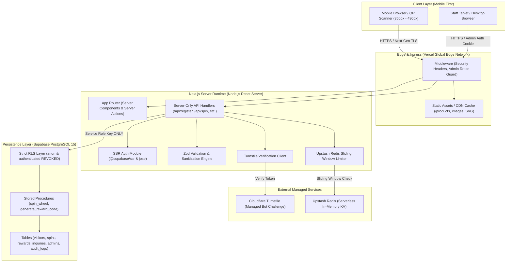
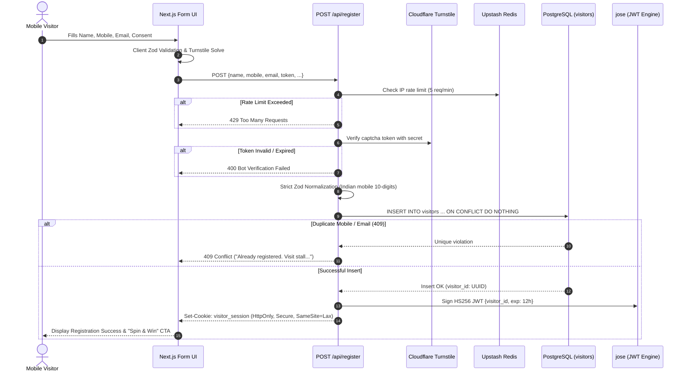
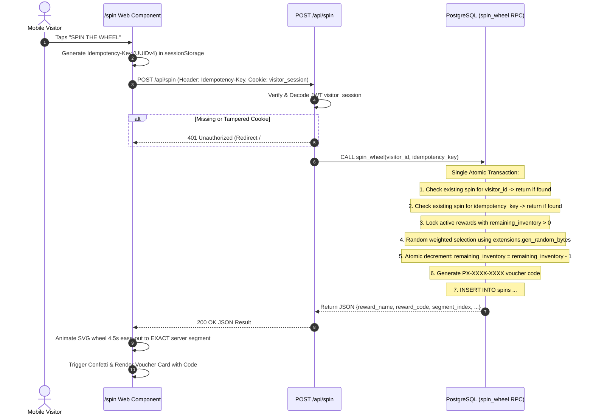
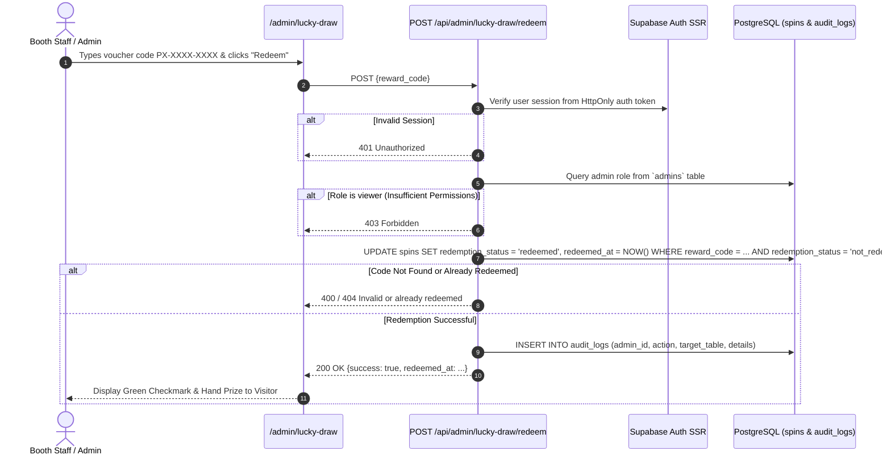

# System Architecture: Pathixo Expo Platform

> **Target**: High-concurrency, mobile-first exhibition lead capture, prize allocation, and analytics platform.  
> **Host Event**: India Expo Centre & Mart  
> **Organization**: PATHIXO PRIVATE LIMITED

---

## 🏗️ 1. High-Level System Architecture



---

## 🔄 2. Key Transactional Workflows

### 2.1 Visitor Registration & Session Issuance


---

### 2.2 Deterministic Cryptographic Spin Allocation


---

### 2.3 Private Admin RBAC & Audit Logging


---

## 🛡️ 3. Security Boundaries & Defense in Depth

```
┌─────────────────────────────────────────────────────────────┐
│ 1. PERIMETER & NETWORK LAYER                                │
│    - Cloudflare Turnstile token enforcement                 │
│    - Upstash Redis sliding-window IP & ID rate limiting     │
│    - Strict HTTP Security Headers (CSP, HSTS, X-Frame DENY) │
└──────────────────────────────┬──────────────────────────────┘
                               │
┌──────────────────────────────▼──────────────────────────────┐
│ 2. APPLICATION RUNTIME LAYER (Next.js Server-Only)          │
│    - Zod schema input validation (reject unknown properties)│
│    - Indian mobile normalization (6-9 start, 10 digits)     │
│    - Cryptographically signed HttpOnly JWT cookies          │
│    - Zero client-side database connections                  │
│    - Neutralization of CSV Formula Injection (=, +, -, @)   │
└──────────────────────────────┬──────────────────────────────┘
                               │
┌──────────────────────────────▼──────────────────────────────┐
│ 3. PERSISTENCE & DATA LAYER (Supabase PostgreSQL)           │
│    - RLS enabled on 100% of tables                          │
│    - Zero privileges granted to `anon` and `authenticated`  │
│    - Service-role only data access with parameterized SQL   │
│    - Atomic inventory decrement guards                      │
│    - Comprehensive audit trail on mutating admin actions    │
└─────────────────────────────────────────────────────────────┘
```

---

## 📈 4. Behavior Under Load & Scaling Strategy

1. **Static Pre-Rendering & CDN Caching**:
   - The entire public showcase (Hero, Positioning, Product Cards, Services, Approach, Why Pathixo, Footer, Privacy, Terms) is pre-rendered at the edge.
   - Catalog queries to `/api/products` are cached via `revalidate: 60`.
2. **Serverless Write Path**:
   - The only write endpoints are `/api/register`, `/api/spin`, `/api/inquiry`, and `/api/events`.
   - All serverless functions communicate with Supabase over HTTPS (PostgREST connection pooling), preventing database socket exhaustion under sudden burst spikes.
3. **Idempotency & Retry Resilience**:
   - In noisy convention hall cellular networks, dropped connections during `/api/spin` are safely retried using the cached `Idempotency-Key` stored in `sessionStorage`, guaranteeing no double-spinning or orphaned deductions.
