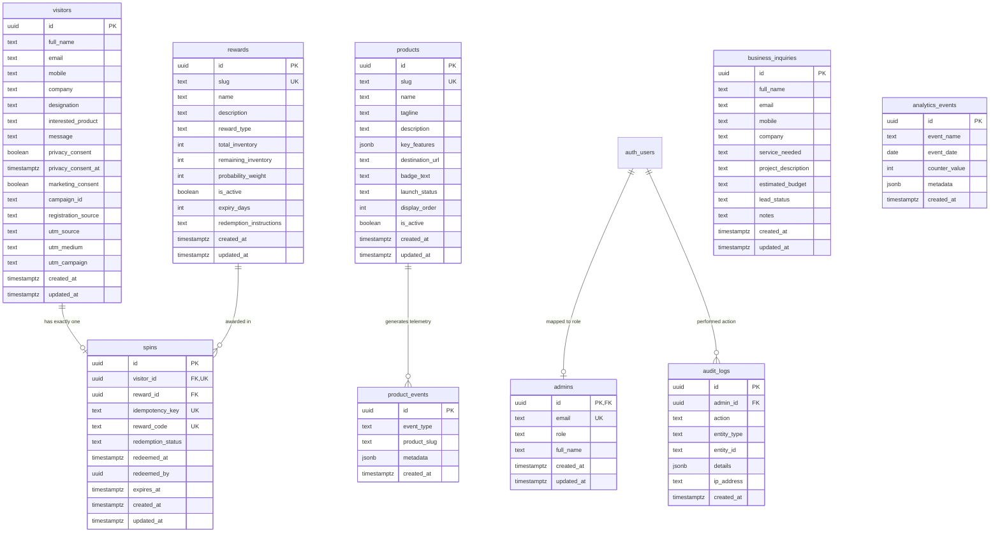

# DATABASE ARCHITECTURE & SCHEMA SPECIFICATION

This document details the PostgreSQL schema, security policies, and cryptographic functions powering the **Pathixo Expo Platform**.

---

## 1. Entity-Relationship Overview



---

## 2. Table Schemas & Constraints

### 2.1 `visitors`
Stores booth attendees who register on the mobile web app.
- **Deduplication Constraints**:
  - `visitors_email_lower_uidx`: Unique index on `lower(trim(email))`.
  - `visitors_mobile_uidx`: Unique index on `mobile`.
- **Validation Constraints**:
  - `mobile`: Must match Indian 10-digit mobile `^[6-9]\d{9}$`.
  - `privacy_consent`: `CHECK (privacy_consent = true)` (mandatory under DPDP/GDPR).
- **Audit Columns**: `privacy_consent_at`, `marketing_consent_at`, `campaign_id`, `utm_*`.

### 2.2 `rewards`
Defines available prizes, vouchers, and fallback entries for the Lucky Draw.
- **Inventory Integrity**:
  - `total_inventory`: Non-negative `CHECK (total_inventory >= 0)`.
  - `remaining_inventory`: Atomic guard `CHECK (remaining_inventory >= 0 AND remaining_inventory <= total_inventory)`.
- **Probability Weight**: `probability_weight >= 0` used by the random selection algorithm.
- **Reward Types**: `discount`, `credit`, `consultation`, `merchandise`, `no_prize`.
- **Status**: Kept inactive (`is_active = false`) until officially approved by Pathixo management.

### 2.3 `spins`
Stores the awarded outcome for each visitor.
- **One Spin Per Visitor**: `UNIQUE(visitor_id)` prevents a visitor from spinning multiple times.
- **Idempotency**: `UNIQUE(idempotency_key)` protects against duplicate submissions due to mobile network retry loops.
- **Voucher Code**: `UNIQUE(reward_code)` format `PX-XXXX-XXXX` using an unambiguous 32-character alphabet (no `0, O, 1, I, L`).
- **Redemption**: Tracks `redemption_status` (`not_redeemed`, `redeemed`, `expired`), `redeemed_at`, and `redeemed_by`.

### 2.4 `products`
Controls the public product cards and catalog shown to visitors.
- **Launch Statuses**: `coming_soon`, `beta`, `live`, `internal`.
- **Ordering**: Controlled by `display_order` and `is_active`.

### 2.5 `business_inquiries`
Captures bespoke software and AI project consultation requests from visitors.
- **Status Pipeline**: `new` $\rightarrow$ `contacted` $\rightarrow$ `qualified` $\rightarrow$ `in_discussion` $\rightarrow$ `converted` $\rightarrow$ `closed`.

### 2.6 `admins` & `audit_logs`
- References Supabase Auth (`auth.users(id)`).
- Enforces three access tiers: `super_admin`, `admin`, `viewer`.
- Every critical admin action, status change, and CSV export is recorded in `audit_logs`.

---

## 3. Row-Level Security (RLS) Architecture

The security model is built on **Zero Client-Side Trust**:
1. RLS is enabled on **100% of tables**.
2. **Zero policies** exist for `anon` and `authenticated`.
3. Table privileges, routines, and sequences are revoked from `anon` and `authenticated`:
   ```sql
   REVOKE ALL ON ALL TABLES IN SCHEMA public FROM anon, authenticated;
   REVOKE ALL ON ALL SEQUENCES IN SCHEMA public FROM anon, authenticated;
   REVOKE ALL ON ALL ROUTINES IN SCHEMA public FROM anon, authenticated;
   ```
4. Access is granted exclusively to `service_role`. All data operations are executed server-side via Next.js server actions and API route handlers using `import "server-only"`.

---

## 4. Cryptographic Spin Function (`spin_wheel`)

The lucky draw decision logic resides entirely within a PostgreSQL transaction function:
`spin_wheel(p_visitor_id UUID, p_idempotency_key TEXT) RETURNS JSONB`

### Execution Guarantees
1. **Idempotency First**: If `visitor_id` has already spun or the `idempotency_key` is seen, returns the existing record with `already_spun = true`.
2. **Cryptographic Randomness**: Uses `gen_random_bytes(4)` rather than standard pseudorandom generators to prevent prediction.
3. **Atomic Decrement with Lock Guard**:
   ```sql
   UPDATE public.rewards
   SET remaining_inventory = remaining_inventory - 1
   WHERE id = v_chosen_reward.id AND remaining_inventory > 0;
   ```
   If a concurrency race occurs and another session claims the last unit, the function retries or falls back cleanly.
4. **Guaranteed Fallback**: If all active inventory is depleted, it assigns the `no_prize` reward so the user never receives a database error.
5. **Code Uniqueness**: Generates an 8-character voucher code (`PX-XXXX-XXXX`) checked for collision before insertion.
