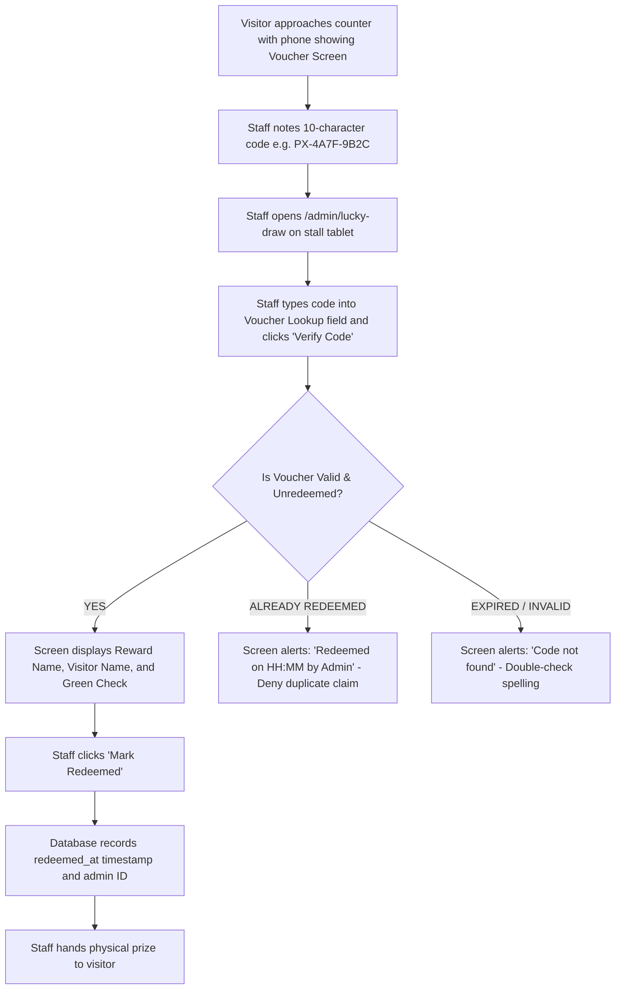

# Event-Day Operational Runbook: Pathixo Expo Platform

> **Location**: India Expo Centre & Mart  
> **Target Audience**: Booth Managers, Stall Technical Leads, and Exhibition Staff  
> **Purpose**: Practical operational procedures for live event execution, booth lead capture, lucky draw redemptions, edge-case handling, and disaster recovery.

---

## 📋 Table of Contents
1. [Pre-Event Timeline (T-24h to T-1h)](#1-pre-event-timeline)
2. [Morning Stall Readiness Checklist](#2-morning-stall-readiness-checklist)
3. [Live Monitoring During the Event](#3-live-monitoring-during-the-event)
4. [Stall Voucher Redemption Workflow](#4-stall-voucher-redemption-workflow)
5. [Visitor Assistance & Edge Cases](#5-visitor-assistance--edge-cases)
6. [Mid-Event Prize & Wheel Adjustments](#6-mid-event-prize--wheel-adjustments)
7. [Disaster Recovery & Degraded Network Fallback](#7-disaster-recovery--degraded-network-fallback)
8. [End-of-Day Protocol (EOD)](#8-end-of-day-protocol-eod)
9. [Post-Event Data Retention & DPDP Compliance](#9-post-event-data-retention--dpdp-compliance)

---

## 1. Pre-Event Timeline

### T-24 Hours (The Day Before)
- [ ] **Database Backup**: Confirm Supabase daily automated backup is active and take a manual snapshot via Supabase Dashboard (`Database > Backups`).
- [ ] **Admin Account Verification**: Ensure at least two stall supervisors have verified login access to `/admin` with valid credentials.
- [ ] **Physical Asset Inspection**:
  - Inspect printed QR code banners, flyers, and table stands.
  - Test scanning from **1.0 to 1.5 meters away** under typical convention hall indoor lighting using both an Android device and an iPhone.
  - Verify the scanned URL decodes to:
    `https://<YOUR_DOMAIN>/?utm_source=expo_mart&utm_medium=qr&utm_campaign=pathixo_expo`
- [ ] **Prize Inventory Check**: Confirm that all physical merchandise (mugs, t-shirts, notebooks, stickers) are counted and stored securely at the stall storage area.
- [ ] **Paper Fallback Forms**: Print 100 copies of the **Emergency Paper Sign-up Sheet** (see Section 7) and stock 5 ballpoint pens.

### T-1 Hour (Booth Opening)
- [ ] **Run System Health Check**: Open `https://<YOUR_DOMAIN>/api/health` in a browser. Confirm response:
  ```json
  {
    "status": "ok",
    "timestamp": "2026-...",
    "database": "reachable"
  }
  ```
- [ ] **Network Latency Check**: Test mobile data connectivity (Airtel & Jio 4G/5G) at the stall. If latency exceeds 2.5s, switch staff admin tablets to booth dedicated Wi-Fi.
- [ ] **Open Admin Redemption Dashboard**: On the primary booth tablet or laptop, log into `https://<YOUR_DOMAIN>/admin/login` and navigate to **Lucky Draw** (`/admin/lucky-draw`).

---

## 2. Morning Stall Readiness Checklist

| Item | Responsible Person | Status | Notes |
|---|---|---|---|
| QR Banners Displayed at Eye Level | Booth Coordinator | [ ] | Front counter + 2 side panels |
| Staff Tablet 1 (Admin / Redemption) | Lead Tech | [ ] | Screen timeout set to "Never", plugged into power bank |
| Staff Tablet 2 (Backup / Inquiries) | Sales Rep | [ ] | Logged in as `admin` |
| Physical Swag Stocked | Inventory Staff | [ ] | Segregated by tier (T-Shirts, Mugs, Notebooks) |
| Paper Fallback Forms & Pens Ready | Booth Coordinator | [ ] | Kept under reception counter |

---

## 3. Live Monitoring During the Event

During exhibition hours, keep the `/admin` Dashboard open on the staff station:

1. **Active Registrations Metric**: Shows real-time count of registered booth attendees.
2. **Spin Conversion Rate**: Monitors the percentage of registered visitors who spun the wheel.
3. **Product Interest Gauge**: Visualizes visitor interest distribution across **Vakxo**, **Crock PDF**, and **Custom Engineering**.
4. **Error Logs**: In the rare event of API degradation, monitor the Vercel deployment log console or Supabase API request charts.

---

## 4. Stall Voucher Redemption Workflow

When a visitor wins a physical reward or voucher on the Spin & Win wheel:



### Step-by-Step Instructions for Booth Staff
1. Greet the attendee and ask them to show their lucky draw result screen.
2. Verify the voucher code formatted as `PX-XXXX-XXXX` (e.g. `PX-4A7F-9B2C`).
3. In `/admin/lucky-draw`, type or paste the code into the **Voucher Redemption** input box.
4. Click **Verify Code**:
   - **Valid**: The visitor's registered name, email, reward title, and expiry are displayed.
   - **Click "Mark Redeemed"**: The system updates the voucher state atomically and writes an audit log.
5. Hand the matching physical swag (or apply the discount code) to the attendee.
6. Smile and invite them to explore our live workstations for **Vakxo** and **Crock PDF**!

---

## 5. Visitor Assistance & Edge Cases

### Case A: Visitor closed their browser tab after spinning
- **Symptom**: Attendee says: *"I spun the wheel, won something, but my tab closed. How do I get my code?"*
- **Resolution**:
  1. Have the visitor re-open `https://<YOUR_DOMAIN>/spin`.
  2. Because their device stores their secure, signed session cookie, the page will automatically detect their prior spin and display their existing reward code immediately.
  3. If they were in Incognito/Private mode and closed the tab:
     - Open `/admin/leads` on the staff tablet.
     - Search by the attendee's mobile number or email.
     - View their detail record: their awarded `reward_code` and reward details are stored in the database.
     - Staff can manually verify the code in `/admin/lucky-draw` and redeem it directly.

### Case B: Visitor gets a "Duplicate Registration" (409) error
- **Symptom**: Attendee tries to register a second time with the same phone number or email to spin again.
- **Resolution**:
  - Explain politely: *"Our lucky draw offers one spin per registered attendee so that everyone has a fair chance to win. Let us look up your first spin result!"*
  - Look up their existing registration on the admin tablet to show them their original voucher code.

### Case C: Visitor has an international phone number
- **Symptom**: Foreign delegate attending the expo wants to register.
- **Resolution**:
  - The standard registration form enforces Indian 10-digit mobile numbers (`^[6-9]\d{9}$`).
  - For international delegates, direct them to use the **"Discuss Your Project"** business inquiry modal on the homepage, or record their details on the **VIP / International Visitor Sheet** for high-priority executive follow-up.

---

## 6. Mid-Event Prize & Wheel Adjustments

All prize quantities and availability can be managed on the fly without deploying code.

### Pausing the Wheel Immediately
If booth crowds become unmanageable or physical prizes temporarily run out:
1. Log in as `super_admin` to `/admin/lucky-draw`.
2. Under **Active Rewards**, toggle all physical items to **Inactive** (`is_active = false`).
3. Ensure the **"Digital Certificate / Special Thanks"** (type: `no_prize`) item remains active.
4. Any visitor who spins will automatically receive the digital thank-you certificate with unlimited inventory.

### Rebalancing Inventory or Adding Stock
If an additional box of 50 Pathixo Tech Mugs arrives at the stall:
1. Navigate to `/admin/lucky-draw`.
2. Find the reward item (e.g. *Pathixo Engineering Coffee Mug*).
3. Increase `total_inventory` by 50 and `remaining_inventory` by 50.
4. Click **Save Changes**. The atomic PostgreSQL function will immediately begin awarding the newly added inventory.

---

## 7. Disaster Recovery & Degraded Network Fallback

Convention halls frequently experience cellular network brownouts when 10,000+ attendees connect simultaneously.

### If Cellular 4G/5G is Completely Down:
1. **Switch to Offline Paper Sign-up**:
   Place the printed **Emergency Lead Capture Sheet** on the counter with pens:

```
========================================================================================
                      PATHIXO EXPO 2026 — VISITOR REGISTRATION
========================================================================================
Full Name         : __________________________________________________________________
Mobile (10 digits): ________________________ Email: ___________________________________
Company / Org     : ________________________ Designation: ____________________________
Product Interest  : [ ] Vakxo  [ ] Crock PDF  [ ] Custom Engineering  [ ] Other
Consent           : [X] I agree to Pathixo Terms & Privacy Policy (DPDP Act 2023)
========================================================================================
```

2. **Offline Lucky Draw Card**:
   - Provide a pre-printed scratch card or numbered token from the backup box.
   - Note the assigned token number on the visitor's paper sheet.

3. **Post-Event Data Ingestion**:
   - Once stable connectivity is restored (e.g. back at the hotel), transcribe the paper sheets into a CSV formatted as:
     ```csv
     full_name,mobile,email,company_name,designation,interested_product,privacy_consent
     "Rahul Sharma","9876543210","rahul@example.com","TechCorp","CTO","vakxo",true
     ```
   - Ingest into the database via the Supabase Dashboard Table Editor (`Insert > Import data from CSV`).

---

## 8. End-of-Day Protocol (EOD)

Perform this sequence every evening immediately after exhibition hall closing:

1. **Export Lead Records**:
   - Log into `/admin/leads`.
   - Click **Export CSV**.
   - Download `pathixo-leads-YYYY-MM-DD.csv`. Store a copy on a password-protected USB drive and send a copy to the Pathixo Sales Lead.
2. **Export Business Inquiries**:
   - Log into `/admin/inquiries`.
   - Click **Export CSV**.
   - Download `pathixo-inquiries-YYYY-MM-DD.csv`.
3. **Reconcile Physical Stock**:
   - Count remaining physical items at the stall.
   - Verify: `Starting Inventory - Redeemed Vouchers in Admin = Physical Count Remaining`.
   - Report any discrepancies to the Booth Supervisor.
4. **Trigger Database Snapshot**:
   - Go to Supabase Dashboard > `Settings > Backups`.
   - Take an on-demand manual snapshot labeled `EOD-Day-N-Snapshot`.

---

## 9. Post-Event Data Retention & DPDP Compliance

Under India's **Digital Personal Data Protection (DPDP) Act, 2023**:

1. **Consent Records**:
   - Every visitor record in the `visitors` table stores `privacy_consent = true` and `privacy_consent_at` (UTC timestamp). These fields must be preserved as proof of legal basis.
2. **Marketing Communications**:
   - Filter all marketing campaigns strictly by `marketing_consent = true`.
   - If an attendee registered without checking marketing consent, they may only be contacted regarding their specific expo inquiry.
3. **90-Day Retention & Deletion Schedule**:
   - Visitors who did not convert into active business discussions and opted out of marketing should be purged or anonymized after **90 days**.
   - Run the redaction query provided in `docs/SECURITY.md` (Section: Data Retention).

---

## 📞 Emergency Escalation Contacts

| Role | Contact Name | Channel |
|---|---|---|
| Booth Manager | Exhibition Coordinator | On-site / Phone |
| Platform Engineering Lead | Technical Architect | Mobile / WhatsApp |
| Infrastructure Support | Supabase / Vercel Status | [status.supabase.com](https://status.supabase.com) / [vercel-status.com](https://www.vercel-status.com) |
